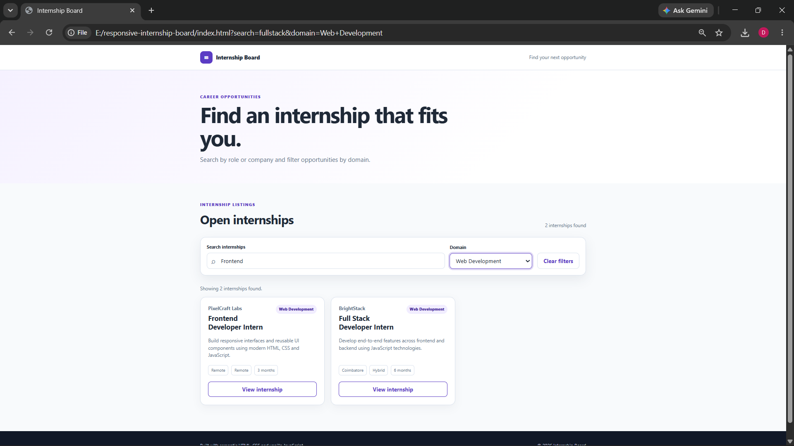
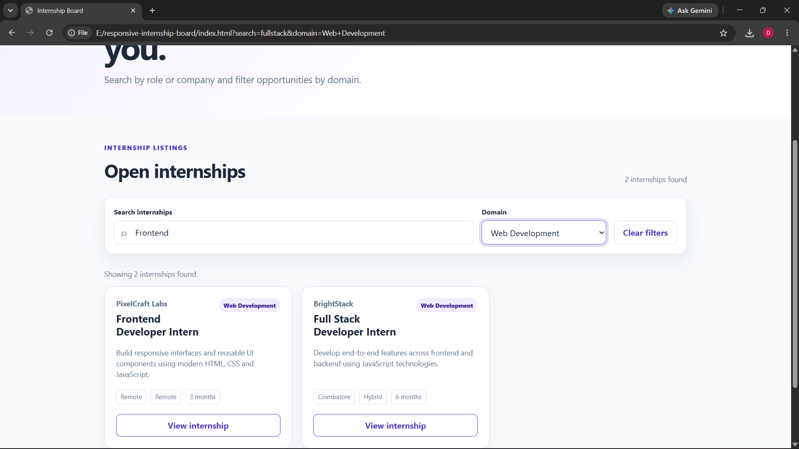
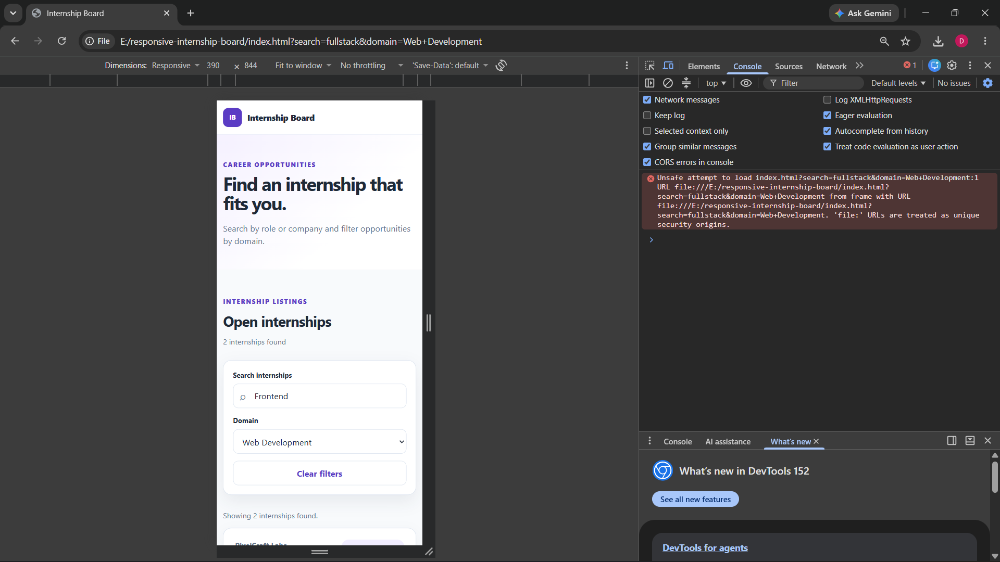
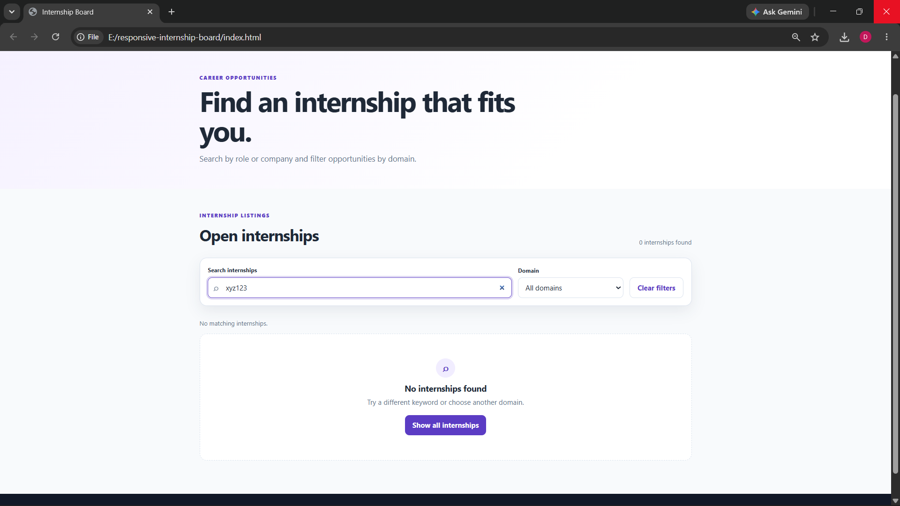

# Screenshot placeholders

For the EdVyro submission requirement, add screenshots to the README showing:

1. Desktop internship board
2. Search/filter result
3. Mobile responsive layout
4. Empty state

After taking screenshots, place them in a `screenshots/` folder and embed them in `README.md`, for example:

```md




```
